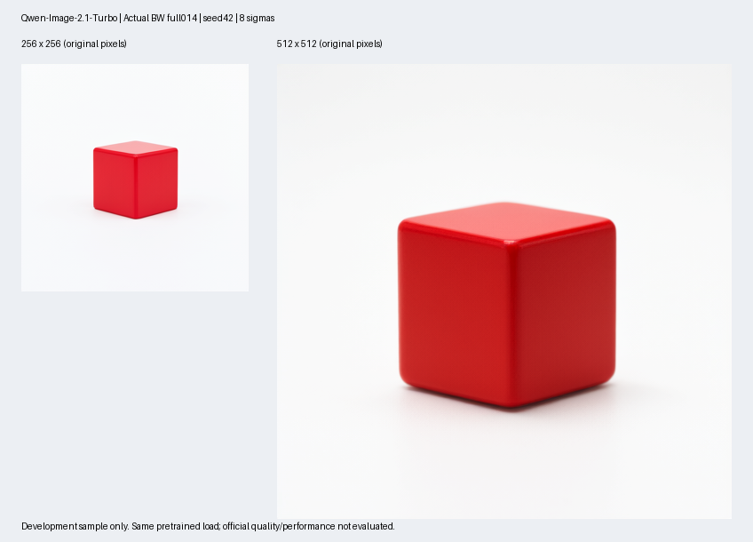

# Qwen-Image-2.1-Turbo on BW ×1 + native DAS SGLang 0.5.12 / fixed Qwen21 port

## 1. 简介

本工程将精确 `Qwen/Qwen-Image-2.1-Turbo` 五组件接入超算互联网单张 BW 64GB 的真实 DAS SGLang。固定发布权重共 16,219,988,836 参数，包含 8.767B Qwen3VL 条件编码器、7.115B QwenImage21 DiT 和 337.740M 四通道 RGBA VAE；保留发布者八个 Turbo sigma、文本模板、pre-final-norm 条件和采样语义。

**014 已完成完整预训练权重真实 BW 推理：同一进程只校验和加载一次，依次生成 256×256、512×512 RGBA PNG。原始 ZIP、全部 17 文件完整 SHA、完整架构与 checkpoint key/shape 双射、native custom loader、10 项源 BF16 实值抽查、八步 CUDA 张量、32 层 prefix cache、PNG 和独立清理均已通过本地审计。两张原图均实际查看，为白背景红色立方体。正式精度、正式性能、官方验收和赛事提交未完成，1024 未测。**

| 获取对象 | 固定来源或交付位置 |
| --- | --- |
| 权重 | [Qwen/Qwen-Image-2.1-Turbo](https://huggingface.co/Qwen/Qwen-Image-2.1-Turbo/tree/fc13ba1986fcb905854dc8de2f52eee395f49b5b)，revision `fc13ba1986fcb905854dc8de2f52eee395f49b5b` |
| 国内固定下载 | `transfer/download-sources009.json`，17 个逐文件 ModelScope commit URL，大小与完整 SHA 对齐固定 HF 内容 |
| 精确 Qwen21 源码 | [SGLang commit efc9849](https://github.com/sgl-project/sglang/tree/efc9849520216b31b8a4a4322399e47e8dbde067)，与精确 Turbo 架构对应 |
| 真实框架 | `sglang 0.5.12+das185.dtk2604.torch2100.2608191739.ga14e79` 与配套 DAS kernel；精确 wheel 在 `dependencies/` |
| 私有备份仓库 | [zhl-2022/guoxin-qwen-image21-turbo-bw-sglang](https://github.com/zhl-2022/guoxin-qwen-image21-turbo-bw-sglang)，实际 push、commit 与 fresh-clone SHA 由外部交付回执记录；评审需获得访问权限 |
| 镜像完整 OCI 引用 | 尚缺；不以候选显示名称代替完整 registry/repository:tag |

这是精确 Qwen21 的 TP1 原生框架兼容 port。native wheel、已有 venv 和权重没有原地修改；没有以 Qwen-Image 2.0 或随机 tiny 网络代替本次完整预训练结果。当前运行入口为有时限的单请求 T2I batch，未启动 HTTP 服务，没有健康端口或外部映射。

| 标准文件或目录 | 作用 |
| --- | --- |
| `env.sh`、`env_check.sh` | 固定模型、框架、BW、TP1、解释器、输出位置；按需采集当前真实环境 |
| `run.sh`、`smoke.sh` | 直接委托已实测的完整 014 runner；独立读回真实输出、源绑定和完整 PNG |
| `verify.py`、`bench.sh` | 官方材料 gate；缺少 evaluator、数据、baseline 和评分接口时退出 2，不制造分数 |
| `core/`、`pretrained/` | 冻结 core010 全部 531 个 payload 和完整 014 原字节，分别保留自身 manifest |
| `full-shapes/`、`vae-load/`、`transfer/` | 实际全架构探针、完整 VAE CPU 探针、独立固定下载器 |
| `dependencies/` | 11 个固定离线 wheel、原 manifest 及隔离 venv bootstrap；不包含通用 GPU 栈替换包 |
| `evidence/`、`archives/` | 完整成功与历史失败原件、独立审计、冻结源包、图片和原始运行记录 |
| `verify_bundle.py`、`delivery-manifest.json` | 精确成员、大小、SHA 检查，支持外部 manifest SHA 和 Git tracked 集合核验 |

## 2. 验证环境

实际平台 notebook 为 `2112237945233408001`，BW ×1。完整运行解释器为 `/root/private_data/guoxin-wan-env-006-001/venv/bin/python`；名称沿用已存在的隔离环境，Qwen 下载 namespace、owner lock 与输出均独立。环境补充原件于 UTC `2026-10-24T09:50:09.050130+00:00` 使用同一解释器采集。

| 组件或配置 | 实测版本或取值 | 证据边界 |
| --- | --- | --- |
| Python | 3.10.12，GCC 11.4.0 | 同解释器 `sys.version` |
| Torch metadata | `2.10.0+das.opt1.dtk2604.20260325.g6b060a` | 原生 `/usr/local/lib/python3.10/dist-packages`；运行 `torch.__version__` 为 `2.10.0`，两者分别保留 |
| HIP / device | `6.3.26093` / `BW` | 014 真实 Torch 运行值；显式使用真正 installed `RocmPlatform` |
| SGLang | `0.5.12+das185.dtk2604.torch2100.2608191739.ga14e79` | 独立 venv 中的原生 DAS wheel，前后 1,989 个 Python 文件 SHA 相同 |
| SGLang kernel | `0.4.2.post2+das185.dtk2604.torch2100.2608191745.ga14e79` | 同解释器 metadata 和固定离线 wheel |
| Transformers | 5.5.0 | 原生系统包，未升级或覆盖 |
| Diffusers | 0.37.0 | 隔离 venv 中的固定 wheel；真实 `FlowMatchEulerDiscreteScheduler` |
| Triton | `3.6.0+gitc73250c4.staging` | 原生系统包；本 profile 关闭新 NVIDIA JIT 优化 gate |
| Pillow | 12.1.1 | 原生系统包；实际 RGBA PNG 完整解码 |
| 权重精度与并行 | BF16、TP1、SP1、batch1、CFG1 | 不量化、不 compile、不 graph；manual chain 中不执行 offload hook |
| 准入显存 | free 68,365,058,048 B / total 68,702,699,520 B | 实际 load 前 `mem_get_info`；64GB 为平台规格称呼 |
| 模型外部目录 | `/root/private_data/guoxin-candidates/models/Qwen-Image-2.1-Turbo-fc13ba1986f` | 全 17 文件重复完整校验 |
| 服务映射 | 无 | 原生 T2I batch，无 HTTP 服务 |

native MM `ServerArgs` 的通用初始化日志仍显示 `dit_cpu_offload=true`、`text_encoder_cpu_offload=true`。本次独立 chain 不调用框架 pipeline 的 offload 调度，明确以 `cpu_offload=False` 将三个组件严格加载到 CUDA；每个真正 forward 与输出设备另有记录。因此不把通用配置日志隐去，也不把它误解为本次实际参数留在 CPU。

完整 OCI 镜像、Notebook CPU/主存/系统盘规格及平台截图索引仍缺本题独立材料。DTK 26.04 来自 DAS 构建标签，不将该标签冒充额外执行过的 SDK 查询。

## 3. 适配优化方案

`core/source-lock.json` 绑定固定上游 Git blob、模型 revision、全部 overlay SHA 和原生 wheel SHA `7c13be91a56b160af81847fffbf4f177b0f07fe0717b4042960ee23846ae7d61`。core010 包含 201 个 Python overlay 模块及 291 个其它原始 source/header 资产；原生包初始化仍真实执行，通过 `MetaPathFinder` 仅选择锁定的模型闭包。

| 改动 | 原因、行为和验证边界 |
| --- | --- |
| namespace finder | 005 实测 `_NamespacePath` 没有 `insert`；007 改为原路径转换成 list 后 prepend，保留原 init 与其余路径 |
| 新版 Qwen21 模型闭包 | 移植精确配置、encoder、DiT、RGBA VAE 和所需源码；固定完整架构不是近似 Qwen2.0 |
| TP1 conditioning 无跨请求 cache | native 0.5.12 没有新版 replica-group API；保留上游 cache 关闭时原函数语义，不合成假分布式函数 |
| 模型内 native RMS / USP | 使用真正 native RMS 的原始 forward；模型内 USP 子类复制固定上游 SP1 replicated-prefix 分支，连接原 K/V 后调用真实 native SDPA；SP>1 拒绝 |
| 真实 SRT 全局配置 | native RoPE 读取独立 SRT args；初始化真正的 `ServerArgs(model_path="None", ...)` 无 SRT 服务模式，发布真正 setter；实际模型由独立 MM 路径绑定 |
| vision TP1 API | 原生 QKV/RowLinear 显式 TP1；旧 PatchEmbed 构造后按真实 `enable_linear` 开关关闭不适用 fast path |
| JIT / 优化资产 | 保留真实 include/csrc 和第三方许可，以满足未修改的 import/path discovery；在实际 HIP 禁用 11 个真实 optional fusion gate，走原始 eager 算法 |
| 严格 native streaming loader | 完整 header key/shape 双射先于 native custom loader；只读 `safe_open` 不走会删除损坏文件的 iterator 分支；禁止 missing 参数回填、重复和 merge 丢片被误认为成功 |
| 位置 buffer | 仅对 012 实测两种 nonpersistent meta buffer 调用原方法或原类重算，其余 meta buffer 拒绝 |
| 014 decode 数值修正 | 保持原 BF16 `std.reciprocal()`、除法、加 mean 顺序；原始像素 `/2+0.5` 后才转 float32 保存，避免以乘 std 改变舍入 |

冻结 `core/compatibility.patch`、`pretrained/013-to-014.patch` 及构建源码保留具体改动。014 的 CPU 回归直接执行未修改的上游纯函数，float32、BF16 与本版逐元素全等；历史乘 std 写法在 512 个 BF16 元素中有 84 个不同、最大差 0.0625。013 因此在 GPU 执行前被 014 替代，原件和草稿仍保留。

完整 header / meta 检查逐键核验 encoder 750、DiT 297、VAE 238 个 tensor。真实参数数分别 8,767,123,696、7,115,124,736、337,740,404；custom-loader 参数分别 232、224、0。本次 014 再次在真实 ROCm 平台复核，并抽查 4+4+2 项加载后的 BF16 源参数，shape、dtype、`torch.equal` 与原字节 SHA 全等。该抽查不等同于逐个 GPU 参数全量回读。

依赖 bootstrap 仅在新的 `/root/private_data/` 目标内创建 `--without-pip --system-site-packages` venv，以 `--no-index --no-deps` 安装 11 个锁定 wheel；原生 Torch、Triton、Transformers、vLLM 等不参与解析替换。已有 venv 和 wheel 均不覆盖，失败新环境保留诊断。新的标准包装不自动修改已经实测的旧环境。

锁定赛事附录的发布方 Diffusers 示例推荐含指定 pipeline PR 的源码版 Diffusers、Transformers≥5.17.0，并列出最高约2048档分辨率。当前工程没有运行该完整 Diffusers pipeline：精确 Qwen21 模型来自固定 SGLang main 闭包，使用真实 native Transformers5.5 的配置/processor 与 Diffusers0.37 的 scheduler 接口，已通过上述真实 CPU、完整架构和 GPU 检查。该实测兼容路线不能被描述为已安装附录推荐的软件栈或已完成其全部分辨率预设。

## 4. 服务启动脚本

本题当前可复现的交付为 bounded batch T2I。`run.sh` 是完整 014 的薄包装，前台运行并接受 SIGINT；runner 内部最长 1,200 秒并在 finally 清理本次模型、进程组和 CUDA cache。没有长期驻留的 HTTP server，不能以 `/health` 成功或聊天 SSE 描述本题。

原始外层命令为 `timeout --signal=INT --kill-after=35 1250` 加以下完整 runner 命令；launch 原件于 UTC `2026-10-24T09:41:41.664054+00:00` 记录 timeout PID29421/start ticks286228536，实际模型进程 PID29422。

```bash
/root/private_data/guoxin-wan-env-006-001/venv/bin/python -B \
  /root/private_data/qwen21-turbo-pretrained014/run_qwen21_pretrained014.py \
  --bundle /root/private_data/qwen21-turbo-core-probe010 \
  --expected-bundle-sha256 73f10aef47106011a31826ce257867cf61ddd3ebd62f94cb23068ab9e275ed0d \
  --shape-receipt /root/private_data/qwen21-full-shapes012-results/full-shapes012.json \
  --resolutions 256,512 \
  --output /root/private_data/qwen21-complete-pretrained014-results \
  --max-seconds 1200
```

完整模型目录准备命令使用独立 `transfer/`。全量下载与 verify 的上限显式 34,000,000,000 B；默认 1GiB 预算不能静默启动 32GB 下载。两个 worker 有 deadline、独立 owner lock、Range partial 保留、完整 SHA 和 join 后释放。全量 download 原件于 UTC09:30:58 完成，verify 于 UTC09:32:10 完成，均早于模型运行。

标准新目录的复现顺序如下。新输出目录必须不存在，且位于源码、checkpoint 之外。先确认该 BW 正由本次实验独占使用。

```bash
python -B verify_bundle.py
python3 -B transfer/download_qwen21_turbo009.py plan --component all --max-bytes 34000000000
# 仅在缺少文件时执行 download；verify 仍完整检查已有字节。
python3 -B transfer/download_qwen21_turbo009.py download --component all --max-bytes 34000000000 --max-seconds 1800
python3 -B transfer/download_qwen21_turbo009.py verify --component all --max-bytes 34000000000 --max-seconds 300
bash run.sh --dry-run
QWEN_OUTPUT=/root/private_data/qwen21-standard007-replay001 bash run.sh
bash env_check.sh > /root/private_data/qwen21-standard007-replay001-env.log
QWEN_OUTPUT=/root/private_data/qwen21-standard007-replay001 bash smoke.sh
python -B verify.py --dry-run
bash bench.sh --dry-run
```

新机器缺少隔离依赖时，可先用原生系统 Python 执行 `python3 -B dependencies/bootstrap_wan_sglang_das_006.py --bundle dependencies --audit-only`，再以 `--target /root/private_data/qwen21-standard007-env001` 建立全新环境，令 `QWEN_PYTHON` 指向其 `venv/bin/python`。该 helper 名称沿用已实测的离线 wheel bootstrap，目标仍是用户明确给定的新目录，不调用 Wan 下载器的 namespace。

本标准薄包装有本地 shell/CLI/完整性和原件 smoke 检查；实际完整 GPU 运行的是上述独立 core010+014。复制冻结源码可证明字节相同，不把包装后的 dry run 写成额外一轮 GPU 重放。

本地还实际通过11项精确完整性测试：错误 SHA、缺件、额外文件、大小写重复、路径越界、根/nested Git管理目录边界及遍历错误均按合同处理。11个离线 wheel 的 CRC、大小、SHA 和 metadata 全部通过；标准 `smoke.sh` 实际读回两张原图通过，精度/性能 gate 均返回预期退出2且没有生成假的结果文件。

## 5. Smoke 测试

输入为 `A red cube on a clean white background.`，seed42、CFG1、batch1。真实 processor 产生 31 个 prompt ID，去掉系统前缀14个后为 `[1,17,4096]` 条件；真正 hook 证明其为 pre-final-norm 输入。

| 完整 GPU 开发检查 | 实测结果 |
| --- | --- |
| 固定权重完整性 | 全 17 文件 32,451,622,214 B，download、verify、014 启动分别完整校验；四个权重共 32,440,133,648 B |
| 完整模型 | 3 个模型组件共 16,219,988,836 参数，native strict loader；无 missing/unexpected，10 项加载实值抽查相等 |
| 采样 | 8 个发布者 sigma 加 terminal0，8 个 DiT / scheduler step；32 层真实 prefix cache |
| sigma 序列 | `[1.0,0.978453,0.95418,0.926626,0.89508,0.845148,0.704534,0.414568,0.0]` |
| 256 PNG | 39,803 B；RGBA256×256；SHA `7518e55e20942d0e8d0179bbc3740acb9e10150425cca0a08cea386785708b3a` |
| 512 PNG | 195,115 B；RGBA512×512；SHA `f5cdbeff7e9078f01ae8268cea297462b398ccc06f404ba4b349f199c01d5f26` |
| 真实设备与数值 | encoder、全部 DiT step、VAE decode 完成于 CUDA:0；conditioning、latent、decoded 均 finite；真实 HIP6.3.26093 / BW |
| native 身份 | 1,989 个原生 Python 文件前后 SHA 全同，绑定固定 DAS wheel；014 三个 driver 文件匹配冻结包 |
| 清理第一层 | runner finally 当时仍 allocated105,528,832 B、reserved192,937,984 B，完整保留，不写成进程内零显存 |
| 清理第二层 | 外 timeout29421精确 start token 已不存在；独立 UTC09:47:30 确认模型 PID29422 absent，hy-smi 显示 VRAM0%、HCU0.0% |



联系图仅把两张原 PNG 按原像素大小放到标注画布；原始图片在 `evidence/full014-raw/qwen21-complete-pretrained014-results/` 保持字节不变。两张输出可见完整红立方体与白背景，这属于开发样例的直观检查，不是正式质量指标。

完整 GPU 原件 ZIP 为256,699 B，SHA `d52e54209eafa1328ac7a8b16253da94f6bab368c2b70f14d42d2f2915aa6a8c`，11 个 payload 的 CRC、export manifest 和 SHA 均通过。补充 runtime / cleanup ZIP 为1,596 B，SHA `38ccf98343e43adaa9ccd58c4ae56003f6ad6784e7efbc22671f05df68cdddd2`，3 个 payload 全部通过。

前置原件也保留：010 两个真实 CPU forward、011 随机小网络五组件八步 RGBA链、012 完整 meta/header 双射和完整 337M VAE 权重 CPU 编解码均真实通过。007/008/009 的真实导入/API失败和 013 未执行 GPU 的数值修订记录分别保留，不覆盖历史状态。

## 6. 精度验证

尚缺本题官方 evaluator、自检、固定图像/文本数据与参考、GPU baseline、评分实现及“劣化不超过2%”的具体比较合同。`official_accuracy_verified=false`、`official_acceptance=false`、`submission_ready=false`；没有 FID、CLIP、人工偏好分或正式 PASS。

已复核锁定的赛事附录 `evidence/official-rules/pdf-text.txt` 第851–875行及2026-10-23赛道快照。Qwen 标题和介绍明确列出“文生图/编辑”能力，通用 T03 要求 encoder→DiT→VAE pipeline、固定 seed、公示 prompt/条件集、GPU参考、CLIP/FID子集和劣化≤2%。在这两份已锁定文字中，未发现“必须同时提交编辑示例”或 Qwen 专属 HTTP/API 规范的明确条款；这只是对所审文本的结论，不能解释为主办方豁免。本次仅覆盖同一 prompt 的两档 T2I，编辑、HTTP、1024及附录2048档均未测，整体仍是开发包而非全项可验收提交件。

本工程的 fullmeta、strict loading、源权重抽查、原始算术 CPU 回归、pre-norm 和开发图片分别证明对应的工程路径，不代替官方质量比较。当前没有使用官方完整 NVIDIA baseline 对同 seed/prompt 的逐像素或分数比较；不能因图片看起来正确而宣称等效精度。

`verify.py` 明确列出官方脚本、数据 manifest、baseline 和评分合同缺项并退出2。即使环境变量存在，也必须先按实际主办方接口实现并核验适配器；当前 gate 不执行不明 CLI、不生成伪造的 `verify_result.json`。缺材料的 gate 返回码不是模型正式评测失败。

## 7. 性能测试

目前仅有一次顺序开发采样，没有正式 warmup、固定样本矩阵、并发、两轮基准或加速比。

| 原始时间或内存 | 数值 | 计时边界 |
| --- | ---: | --- |
| 完整 runner | 131.5344329327345 s | 全文件 SHA、导入、原生源码核验、严格加载、两图、清理 |
| 校验与加载累计 | 111.28790879901499 s | 从 runner 开始到全部权重加载完成，不能当纯加载时间 |
| 256 样例 | 12.086361807771027 s | 包含条件编码、八步、VAE、张量摘要和保存验证；首轮编译/初始化效应未分离 |
| 随后512样例 | 1.1135749416425824 s | 同进程同权重继续运行，缓存/冷暖条件不同 |
| 256峰值 allocated / reserved | 32,783,264,768 /35,334,914,048 B | 进程累计 CUDA allocator 峰值 |
| 512后峰值 allocated / reserved | 33,407,691,776 /35,498,491,904 B | 同进程累计峰值，不是单请求净增 |

上述两分辨率顺序时间不能用于声称分辨率越高越快、正式吞吐、优化收益或 NVIDIA 对比。`bench.sh` 保持官方材料 gate，尚无本题正式分辨率、prompt、step、batch/并发、质量阈值、预热与两轮计时合同，`official_performance_verified=false`。不套用聊天任务4K/16K文本负载充数。

## 8. 注意事项与交付边界

- 1024、参考图编辑、多图、alpha细节质量、长提示词、多并发、HTTP、graph/compile、offload、量化、TP/SP>1 均未由本次完整模型运行覆盖；入口仅允许明确的 T2I batch profile。
- 日志保留 NUMA balancing、DAS SDPA/flash-attn 接口、未编译 memory-efficient attention 等警告。实际原生 Torch SDPA 完成，并未据此改系统 NUMA、覆盖 native kernel 或启用 NVIDIA JIT。
- 权重与 VAE config/tokenizer、原始 sigma、模型结构保持固定源身份；新 compat 闭包只用于实际接口和执行路径。旧 frozen 包、真实失败和历史 README 保留原字节，其当时 pending 文本不覆盖本报告对应原件结论。
- Qwen 模型保留 `Qwen RESEARCH LICENSE AGREEMENT`；上游 SGLang Apache-2.0、JIT include/csrc 的 NVIDIA/第三方 notices、所有 wheel 内各自许可继续保留。新编工具保留版权，未为整个仓库选择 MIT 或其它新开源许可。
- 代码包不含32GB权重、venv、cache或正在运行的目录。只有已锁定的 wheel 属于离线依赖。`.gitattributes` 使用 `* -text` 保持 Windows/Linux 字节；精确 verifier 仅豁免根 `.git/` 真实管理目录，其他额外文件均报错，遍历错误不会静默跳过。
- 私有 GitHub push、实际 commit、fresh-clone 全文件 SHA/ tracked 集合的证明放在封包后的外部回执，避免将 ZIP 自身 SHA 或 Git commit 写入其自身文件形成循环。光合 GitLab 导入和评审访问另行核验。
- 完整 OCI 镜像与平台规格证据、官方精度/性能/验收、标准薄包装 GPU复跑和最终表单仍是独立事项。本交付为已核验的开发工程；最终赛事提交由参赛者手动完成，`submitted=false`。
